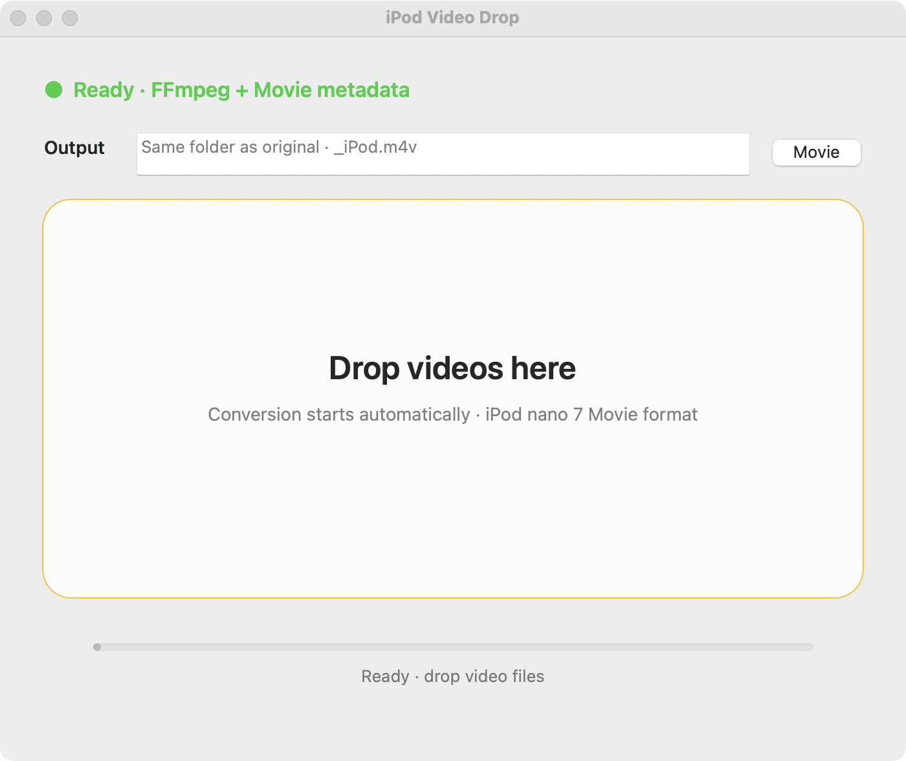

<p align="center">
  
</p>

<h1 align="center">iPod Video Drop</h1>

<p align="center">
  Drop any video, get an <code>.m4v</code> that iPod nano 7 plays — and files under <b>Movies</b>.<br>
  A tiny native macOS front end for FFmpeg and AtomicParsley.
</p>

<p align="center">
  
</p>

## Why

The iPod nano 7th generation is picky: H.264 Baseline only, at most 640×480, constant frame rate, AAC-LC audio. Get one of them wrong and the file either refuses to sync or plays without picture. And even a valid file usually ends up under *Home Videos* or *Music Videos* with empty artist/album fields, because the container carries the wrong media-kind tag.

iPod Video Drop bakes the known-good recipe into a drop zone: it encodes to exactly what the nano accepts and stamps the file as a **Movie**.

## What it produces

| | |
| --- | --- |
| Container | `.m4v` (`-f ipod`, `+faststart`) |
| Video | H.264 Baseline, Level 3.0, `yuv420p`, CRF 21, preset `medium` |
| Frame size | fits inside 640×480, aspect ratio preserved, even dimensions |
| Frame rate | 30 fps, constant |
| Audio | AAC-LC, 160 kbps, stereo, 44.1 kHz |
| Streams kept | first video + first audio track; subtitles, chapters and source metadata are dropped |
| Metadata | `stik = 9` (Movie), written by AtomicParsley after a `--metaEnema` wipe |

**Portrait clips** are detected with `ffprobe` and rotated 90° counter-clockwise before scaling, so a phone video fills the nano's landscape screen instead of becoming a thin strip.

The result is saved next to the source as `<name>_iPod.m4v`. Encoding goes to a temporary `<name>_iPod.tmp.m4v` first, so a failed conversion never leaves a half-written file behind. An existing `_iPod.m4v` with the same name is overwritten.

## Requirements

- macOS 12 Monterey or later (Apple Silicon or Intel)
- [Homebrew](https://brew.sh) with `ffmpeg` and `atomicparsley`:

  ```bash
  brew install ffmpeg atomicparsley
  ```

  If they are missing, the app runs that command itself on first launch (status: *Installing required tools…*) and turns green when ready. Tools are looked up in `/opt/homebrew/bin`, `/usr/local/bin` and `/usr/bin`.

## Install

Grab `iPodVideoDrop-v1.0.zip` from [Releases](../../releases), unzip and move **iPod Video Drop.app** to `/Applications`.

The build is not notarized, so on first launch right-click the app → **Open**, or clear the quarantine flag:

```bash
xattr -dr com.apple.quarantine "/Applications/iPod Video Drop.app"
```

## Build from source

Needs only the Xcode Command Line Tools (`xcode-select --install`):

```bash
git clone https://github.com/Kreal-exe/iPodVideoDrop.git
cd iPodVideoDrop
./build.command
```

The script compiles `iPodVideoDrop/main.m` with `clang` (universal arm64 + x86_64), generates the icon from `iPodVideoDropIcon.png`, ad-hoc signs the bundle, installs **iPod Video Drop.app** into `/Applications` and opens it (a running copy is quit first). It builds in a temporary folder, so nothing is written into the project. You can also just double-click `build.command` in Finder.

- `INSTALL_DIR=~/Applications ./build.command` installs somewhere else.
- `./build.command --zip` also writes `dist/iPodVideoDrop-v1.0.zip` for a release.

## Usage

1. Launch the app and wait for **Ready · FFmpeg + Movie metadata**.
2. Drop one or more video files onto the window. They are converted one after another; the progress bar advances per file.
3. When the status reads `Done · N files → .m4v · Movie (stik=9)`, drag the new `_iPod.m4v` files into the **TV** app (iTunes on macOS Mojave and earlier) — they appear under *Movies*.
4. Sync the iPod from Finder → your iPod → **Movies**.

There is no completion pop-up by design; ⌘Q quits. If a file fails, the status line shows the first useful line of FFmpeg's or AtomicParsley's output.

## The equivalent commands

If you would rather script it, this is what the app runs for a landscape source:

```bash
ffmpeg -hide_banner -loglevel error -nostdin -y -i input.mov \
  -map 0:v:0 -map 0:a:0? -sn -dn -map_metadata -1 -map_chapters -1 \
  -vf "scale=640:480:force_original_aspect_ratio=decrease:force_divisible_by=2" \
  -r 30 -fps_mode cfr \
  -c:v libx264 -preset medium -crf 21 -profile:v baseline -level:v 3.0 -pix_fmt yuv420p \
  -c:a aac -aac_pns 0 -b:a 160k -ac 2 -ar 44100 \
  -movflags +faststart -f ipod output_iPod.m4v

AtomicParsley output_iPod.m4v --metaEnema --stik value=9 --overWrite
```

For portrait sources the filter becomes `transpose=2,scale=640:480:…`.

## Repository layout

- `iPodVideoDrop/main.m` — the whole app
- `iPodVideoDrop/main-horizontal.m` — an earlier variant without portrait auto-rotation, kept for reference; not used by the build
- `build.command` — build script

## License

[MIT](LICENSE)
